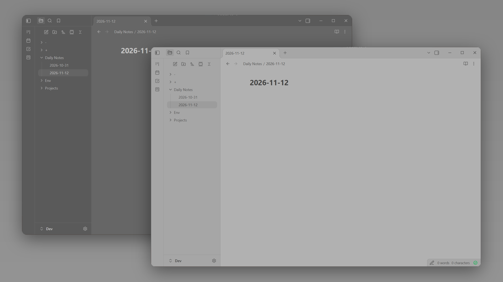

# TwoShadesOfGrey

A flat, quiet theme for [Obsidian](https://obsidian.md) built from two greys and one blue.

- **Dark mode** is a mid-dark grey (`#666666`) with soft, toned-down text rather than stark white.
- **Light mode** is a mid-light grey (`#b1b1b1`) with charcoal text, so there is no bright white anywhere on screen.
- Sidebars, ribbon, tab bar and title bar sit one step darker than the note in both modes.
- A single blue accent for links, tags, bullets and selection.
- No glow, no glass, no textures, no extra fonts.

Both modes are low-contrast by design, for people who find pure black or pure white backgrounds tiring.

## Install

Once the theme is listed in the community directory:

1. Open **Settings → Appearance**.
2. Under **Themes**, select **Manage**.
3. Search for **TwoShadesOfGrey** and select **Install and use**.

### Manual install

1. Download `manifest.json` and `theme.css` from the [latest release](https://github.com/AshOtis/TwoShadesOfGrey/releases/latest).
2. Put both files in `<your vault>/.obsidian/themes/TwoShadesOfGrey/`.
3. Open **Settings → Appearance** and choose **TwoShadesOfGrey** under **Themes**.

## Notes

- The Help button at the bottom of the left sidebar is hidden.
- Requires Obsidian 1.5.0 or later.

## License

[MIT](LICENSE)
